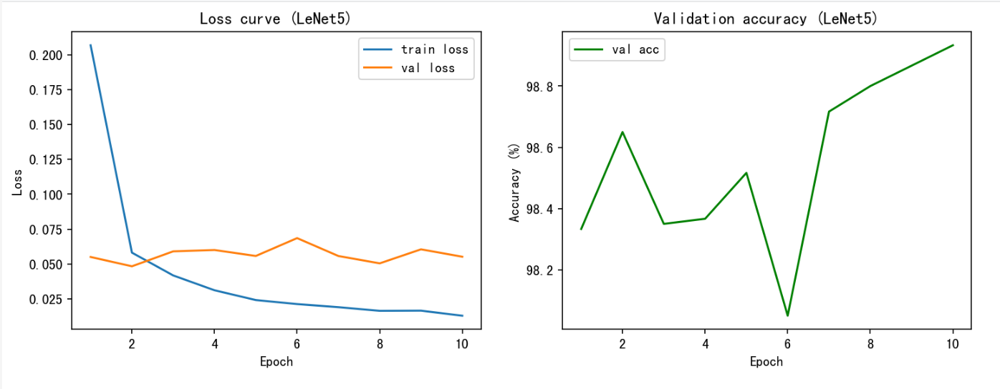
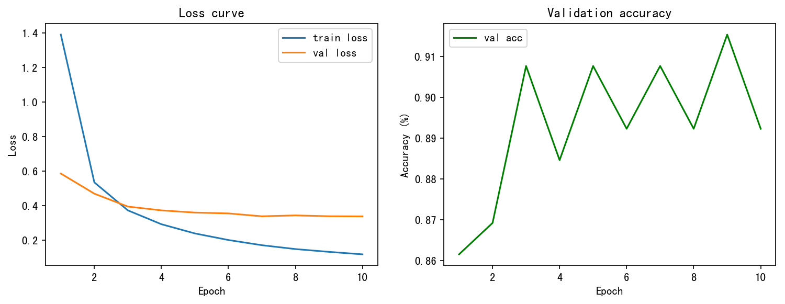
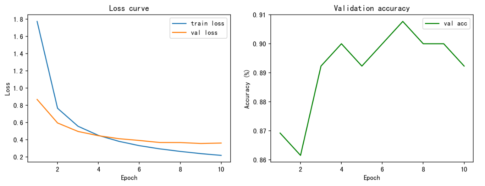
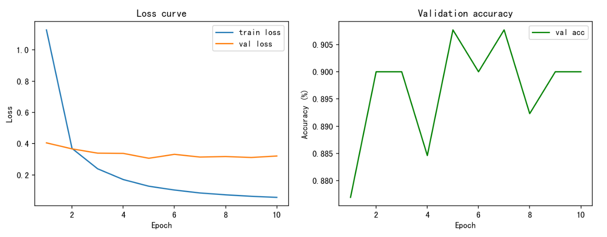
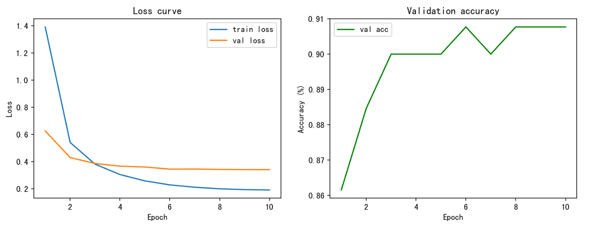
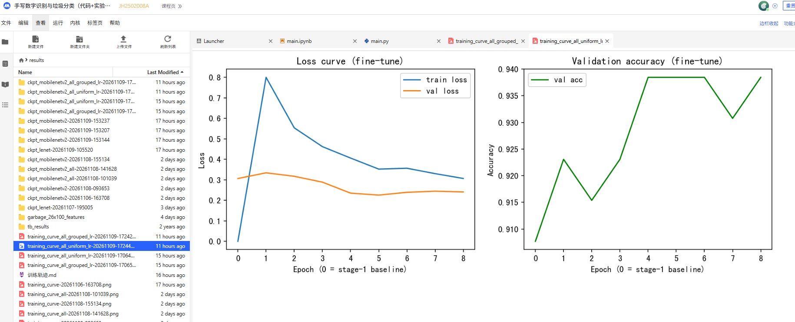
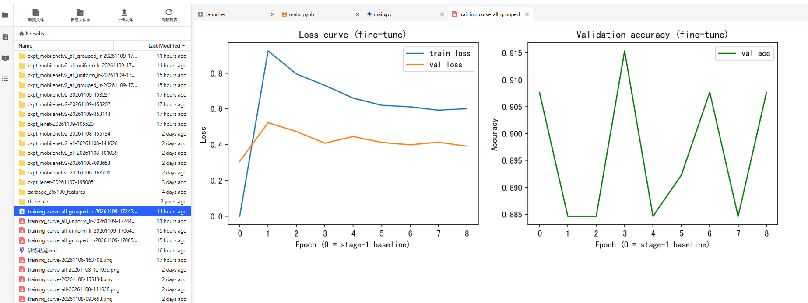

# 课程实验报告

## 一、手写数字识别

### 1. 实验目标与环境

本实验使用 MNIST 数据集训练 LeNet-5，对 0～9 共 10 类手写数字进行分类。模型输入为灰度图像，原始 28×28 像素图像缩放到 32×32 后进行归一化。训练和评测使用 MindSpore，运行设备为 CPU。

官方训练集共 60,000 张图像，按固定随机种子 42 划分为 **54,000 张训练图像**和 **6,000 张验证图像**。验证集只用于每轮评估和选择权重，不参与梯度更新。**官方测试集包含 10,000 张图像，在确定模型后用于最终评测**。

### 2. 模型与训练设置

LeNet-5 由两组卷积和最大池化层，以及三层全连接层组成。卷积通道数为 1→6→16，全连接层维度为 400→120→84→10；**前两层卷积和前两层全连接后使用 ReLU。输出层使用 Softmax 交叉熵损失进行分类**。

**训练使用 Momentum 优化器，学习率为 0.01，动量为 0.9，batch size 为 32，共训练 10 轮**。每轮结束后计算验证集损失和准确率；**优先保留验证准确率较高的权重**，准确率相同时选择验证损失较低的权重。训练脚本同时保存逐轮指标、模型权重和训练曲线。

### 3. 训练曲线与测试结果



图 1　LeNet-5 的训练曲线。训练损失从第 1 轮约 0.207 降到第 10 轮约 0.012。验证损失在约 0.049～0.069 之间波动，没有随训练损失持续下降；验证准确率虽有小幅起伏，整体维持在 98% 以上，并在第 10 轮达到曲线中的最高值，约为 98.93%。

随后使用第 10 轮权重 `lenet-10.ckpt` 对官方测试集进行评测。测试集共 10,000 张图像，按 batch size 100 分为 100 批；得到准确率 **98.94%**，平均损失 **0.0439**。该测试准确率来自独立测试集评估，与上图中的验证准确率是不同数据集上的指标。

### 4. 手写识别结果小结

本次 LeNet-5 训练在验证集和官方测试集上都取得了较高准确率。验证准确率后几轮总体上升，但验证损失有波动，训练损失则继续下降，因此不能只根据训练损失判断模型表现。测试集准确率为 98.94%，作为本次手写数字分类实验的最终测试结果。

### 5.对应的实验文件

训练文件：[zju/手写和垃圾分类/lenet_mnist.py at master · Yangguangxiaokeji/zju](https://github.com/Yangguangxiaokeji/zju/blob/master/手写和垃圾分类/lenet_mnist.py)

测试文件：[zju/手写和垃圾分类/lenet_mnist_main.py at master · Yangguangxiaokeji/zju](https://github.com/Yangguangxiaokeji/zju/blob/master/手写和垃圾分类/lenet_mnist_main.py)


## 二、垃圾分类

### 1. 实验目的

在浙江大学 momodel 平台（mo.zju.edu.cn）上，基于 MindSpore 框架和 MobileNetV2 预训练模型完成 26 类垃圾图像分类任务，通过**迁移学习**尽可能提高平台系统测试的得分。

### 2. 实验环境

| 项目 | 说明 |
| --- | --- |
| 训练方式 | momodel 离线作业；另进行 CPU 重复实验，检查训练与学习率调度 |
| CPU 重复实验环境 | Python 3.10.19 |
| CPU 重复实验依赖 | MindSpore 2.11.0、NumPy 1.26.4、OpenCV 4.11.0、Matplotlib 3.10.8、EasyDict 1.13 |
| 测试方式 | 平台系统测试，使用未参与训练的测试图像 |
| 深度学习框架 | MindSpore，GRAPH_MODE |
| 模型结构 | MobileNetV2 backbone + 分类 head（GlobalPooling + Dense），分阶段选择是否解冻 backbone |
| 预训练权重 | mobilenetv2-200_1067_cpu_gpu.ckpt（平台提供，ImageNet 预训练） |
| 数据集 | garbage_26x100，26 类垃圾，每类约 100 张 |
| 输入尺寸 | 224 x 224，batch_size = 24 |

26 个类别包括塑料瓶、帽子、报纸、易拉罐、玻璃器皿、纸板、电池、荧光灯、橘子皮、菜叶、蛋壳、香蕉皮等，对应平台固定的标签字典 inverted（0~25）。

数据集中共有 2343 张训练图像、130 张验证图像，验证集每类 5 张。训练按 batch_size=24 分批，每轮有 97 个完整批次，共使用 2328 张图像，其余 15 张因 drop_remainder=True 被舍弃。验证按 batch_size=10 分批，13 个批次可以覆盖全部验证图像。

### 3. 总体方案

采用两阶段迁移学习：

- 阶段一（train_main.py）：冻结预训练 backbone，只训练分类 head。
- 阶段二（train_main_all.py）：加载阶段一最优权重，解冻 backbone 和 head，直接读取图片进行微调。先采用统一学习率，再尝试分组学习率。

阶段一先按完整批次提取训练图像的特征，**将 feature map 和标签保存为 feature_i.npy、label_i.npy，存放在 results/garbage_26x100_features 下。之后每轮读取缓存，只对分类 head 做前向和反向计算**。backbone 参数固定，不需要在每轮重新计算特征，因此可以减少 CPU 训练时间。

***缓存也限制了增强的多样性。随机裁剪、翻转和颜色调整只在生成缓存时抽样一次，head 后续每轮读取的仍是同一批特征***。***全网微调改为每轮读取原图，重新生成随机增强，并同时调整特征提取网络。***

### 4. 实验过程

### 4.1 原始训练与提交文件的改造

原始流程缺少每轮验证，提交代码与训练模型也存在不一致。对 train_main.py、main.ipynb 和 main.py 的改造主要包括：

1. **验证与选模**：使用 val 集评估，每轮记录验证 loss 和准确率，按最高验证准确率选择权重。
2. **结果归档**：每次创建带时间戳的 checkpoint 文件夹，将权重和 training_curve.png 放在一起，并在 results/训练轨迹.md 中追加超参数、文件夹和曲线。
3. **缓存复用**：提取特征时跳过已有缓存，减少重复计算。
4. **提交对齐**：main.py 只保留模型加载与 predict()；统一训练和提交模型的 Head 为 has_bias=True，将 model_path 指向所选权重，并保持图像归一化和通道顺序一致。

原始提交得分为 55，一次提交因包含训练流程、Head 不匹配及权重路径问题降至 45。修正这些问题后，使用改造后的流程进行基准训练，结果见下一节。

### 4.3 改造后的基准训练与结果

完成上述改造后，冻结 MobileNetV2 backbone，只训练分类 head，采用以下配置进行基准训练。该次训练和系统测试结果作为后续超参数调整及全网微调的对照。

| 超参数 | 取值 |
| --- | --- |
| epochs | 10 |
| lr_max | 0.01 |
| decay_type | constant |
| momentum | 0.8 |
| weight_decay | 0.0001 |
| batch_size | 24 |
| 优化器 | nn.Momentum |
| 损失函数 | SoftmaxCrossEntropyWithLogits(sparse=True, mean) |

训练曲线的最高验证准确率出现在第 9 轮，为 91.54%，对应权重 mobilenetv2-9.ckpt，系统测试得分也为 91.54。后续微调开始前，在相同验证集上重新评估该权重，准确率为 0.9153846，验证损失为 0.337953。



图 1　阶段一训练曲线。第 10 轮的训练损失继续下降，但验证准确率低于第 9 轮，因此提交时选用第 9 轮权重。右图纵轴刻度使用 0～1 的比例，0.9154 对应约 91.54%。

### 4.4 超参数调整实验与结果对比

#### 4.4.1 本轮三组单因素实验

在平台上完成第 1、2、3 组三次 head 训练实验。三组均保持 backbone 冻结，沿用缓存特征训练分类 head，只分别改变学习率或衰减方式。共同配置为：epochs=10、momentum=0.8、weight_decay=0.0001、batch_size=24、eval_batch_size=10、reduction=mean，输入尺寸为 224×224；数据路径、特征缓存路径及模型结构保持不变。本轮没有执行其他推荐组的实验。

训练参数、最佳轮次和验证指标取自[平台训练轨迹截图](report_images/head_hparam_runs_20261109.png)，系统测试得分按三组对应权重的实际测试结果记录。表中的验证损失均对应所选最佳轮次；原基线的 0.337953 沿用第 4.3 节相同验证集上的复评结果。

| 实验 | lr_max | decay_type | 最佳轮次 | 最佳验证准确率（%） | 对应验证 loss | 系统测试得分 | 较原基线得分变化 |
| --- | --- | --- | --- | --- | --- | --- | --- |
| 原基线 | 0.01 | constant | 9 | 91.54 | 0.337953 | 91.54 | — |
| 第 1 组：降低学习率 | 0.005 | constant | 7 | 90.77 | 0.366998 | 90.00 | -1.54 |
| 第 2 组：提高学习率 | 0.02 | constant | 5 | 90.77 | 0.306713 | **93.85** | **+2.31** |
| 第 3 组：余弦衰减 | 0.01 | cosine | 6 | 90.77 | 0.344853 | 91.54 | 0.00 |

三组最高验证准确率的原始记录均为 0.907692，即约 90.77%。验证集共 130 张图像，对应识别正确 118 张，比原基线的 119 张少 1 张。三组验证准确率相同，但系统测试得分不同，不能把验证准确率直接当作系统测试成绩。

各组参数与权重的对应关系如下；原始训练曲线均位于相应 checkpoint 文件夹中的 training_curve.png。

| 实验 | checkpoint 文件夹 | 系统测试所用权重 |
| --- | --- | --- |
| 第 1 组 | `results/ckpt_mobilenetv2-20261109-153144/` | `mobilenetv2-7.ckpt` |
| 第 2 组 | `results/ckpt_mobilenetv2-20261109-153207/` | `mobilenetv2-5.ckpt` |
| 第 3 组 | `results/ckpt_mobilenetv2-20261109-153237/` | `mobilenetv2-6.ckpt` |

#### 4.4.2 训练曲线与结果分析



图 2　第 1 组训练曲线，截取自平台训练轨迹。训练 loss 从约 1.78 降至 0.22，验证 loss 在前几轮下降较快，后几轮下降放缓。第 7 轮验证准确率最高，为 90.77%，对应验证 loss 为 0.366998；随后验证准确率有所回落。该轮权重的系统测试得分为 90.00，低于原基线 1.54 分。降低学习率没有在本次实验中带来收益。



图 3　第 2 组训练曲线，截取自平台训练轨迹。训练 loss 从约 1.12 降至 0.06，比第 1 组下降更快；验证 loss 后几轮主要在约 0.31～0.34 之间波动，没有随训练 loss 持续下降。第 5 轮首次达到最高验证准确率 90.77%，对应验证 loss 为 0.306713，按原脚本的选择规则使用 mobilenetv2-5.ckpt。该权重的系统测试得分为 **93.85**，比原基线提高 **2.31 分**，是本次已记录实验中的最高系统测试得分。



图 4　第 3 组训练曲线，截取自平台训练轨迹。训练 loss 从约 1.39 降至 0.19，验证 loss 前期下降，后期趋于平稳。第 6 轮首次达到最高验证准确率 90.77%，对应验证 loss 为 0.344853，后几轮多次保持相同准确率。所选 mobilenetv2-6.ckpt 的系统测试得分为 91.54，与原基线持平。余弦衰减在本次实验中没有提高系统测试得分。

本轮结果表明，在冻结 backbone、只训练 head 的设置下，将学习率从 0.01 提高到 0.02 的这次实验取得了更高的系统测试得分。

### 4.6 全网微调：统一学习率实验

新建 train_main_all.py，加载阶段一的 mobilenetv2-9.ckpt，保持 head 结构不变，解冻 backbone 和 head 的可训练参数。训练改为直接读取图片，每轮重新进行随机增强。

初版全网微调的参数如下：

| 参数 | 取值 |
| --- | --- |
| epochs | 8 |
| backbone 与 head 的 lr_max | 均为 0.002 |
| decay_type | cosine |
| warmup_steps | 0 |
| momentum | 0.9 |
| weight_decay | 0.0001 |
| 训练 / 验证 batch_size | 24 / 10 |
| 随机裁剪面积比例 | 0.08～1.0 |
| 水平翻转概率 | 0.5 |
| brightness / contrast / saturation | 均为 0.4 |

每轮训练后切换到验证模式，计算验证损失和准确率，再保存该轮权重。每次实验使用独立的时间戳目录，阶段一权重不被覆盖。离线作业仍需勾选训练脚本、src_mindspore、数据集以及阶段一权重文件。

训练开始前，先将原始阶段一权重作为 epoch 0 评估，并加入最佳轮次的候选。这个处理只能保证选出的权重在当前验证集上不低于基线，不能保证隐藏测试集的分数也不下降。

平台实验完成后，第 6 轮验证准确率最高，为 95.38%，验证损失从曲线看约为 0.16。对应权重为：

```text
results/ckpt_mobilenetv2_all-20261108-101039/mobilenetv2_all-6.ckpt
```

将该权重用于系统测试，得分为 90.77，低于阶段一的 91.54，相差 0.77 分。



图 5　平台统一学习率实验的训练曲线。第 6 轮验证表现最好，随后两轮验证损失回升。第 0 轮的 train loss=0 是脚本用于绘图的占位值，不是实测训练损失。

训练损失从约 0.78 降至 0.28，验证损失到第 6 轮也在下降，训练过程没有出现发散。第 7、8 轮训练损失继续降低，验证表现略有回退，但系统测试使用的是第 6 轮模型，因此不能用后两轮的回退直接解释测试得分下降。

这次实验提高了验证准确率，却没有提高系统测试得分。验证集只有 130 张，阶段一正确识别 119 张，95.38% 对应正确识别 124 张，实际多识别对 5 张。这个变化还不足以说明模型对其他图像也有同样的提升。

### 4.7 CPU 重复实验与运行环境修正

为检查训练脚本与学习率调度的实际执行，对统一学习率全网微调进行了一次 CPU 重复实验。本节记录训练和验证结果，未开展平台系统测试。

实验环境最初缺少 MindSpore。安装后，NumPy 2.2.6 与当前 MindSpore 二进制模块不兼容，张量运算出现 _ARRAY_API 和 multiarray 导入错误。将 NumPy 调整为 1.26.4，使训练能够启动；同时将 OpenCV 调整为 4.11.0，以避免它对 NumPy 2 的版本要求。

环境调整后，张量运算、图像读取、checkpoint 加载和 GRAPH_MODE 梯度更新均能执行，pip check 未发现依赖冲突。在项目目录中使用配置好的环境，即可用 python train_main_all.py 运行训练。

学习率实现也做了修正。旧版 TrainingWrapper 在 construct 中给 opt.lr 赋值，但该属性不是 Momentum 实际读取的 learning_rate。重复实验前改为将完整的学习率数组直接传给 nn.Momentum，配合 nn.WithLossCell 和 nn.TrainOneStepCell 训练。日志按 step 打印学习率，可以检查衰减是否执行。BN 的运行均值、方差排除在梯度参数之外，由前向计算按训练模式更新。

CPU 重复实验每轮 97 个批次，8 轮共 776 次更新。各轮训练循环累计耗时约 40.6 分钟，不含验证和绘图时间。完整日志保存在 results/train_main_all-20261108-101250.log，结果如下：

| epoch | train loss | val loss | val acc（%） |
| --- | --- | --- | --- |
| 0，阶段一基线 | — | 0.337953 | 91.54 |
| 1 | 0.816160 | 0.321974 | 90.77 |
| 2 | 0.523080 | 0.282907 | 93.08 |
| 3 | 0.457869 | 0.270138 | 92.31 |
| 4 | 0.418581 | 0.267530 | 92.31 |
| 5 | 0.380713 | 0.255185 | 92.31 |
| 6 | 0.332459 | 0.245101 | 93.08 |
| 7 | 0.308656 | 0.237882 | 94.62 |
| 8 | 0.337998 | 0.249143 | 92.31 |



图 6　CPU 重复实验的训练曲线。第 7 轮验证准确率最高，为 94.62%；第 8 轮训练损失和验证损失均有回升。第 0 轮的训练损失仍为绘图占位值。

CPU 重复实验的最佳权重为 results/ckpt_mobilenetv2_all-20261108-101253/mobilenetv2_all-7.ckpt。该实验只记录了训练和验证结果，没有单独的系统测试得分，不能将第 4.6 节平台实验中第 6 轮模型的 90.77 得分记到本次模型上。两次运行的最佳轮次不同，脚本也没有显式固定随机种子，随机增强、数据顺序和运行环境的差异都可能影响结果，需要重复实验才能判断稳定性。

### 4.8 全网微调：分组学习率实验

统一学习率实验没有提高系统测试得分，接着尝试减小 backbone 的更新幅度。阶段一只有约 3.3 万个 head 参数参与训练，解冻后可训练参数增加到约 226 万个，其中 backbone 有 2223872 个，head 有 33306 个。用阶段一学习率的五分之一更新整个网络，并不能直接说明改动足够保守。

本次给两部分设置不同的最大学习率：

| 参数 | 统一学习率实验 | 分组学习率实验 |
| --- | --- | --- |
| backbone_lr_max | 0.002 | 0.0001 |
| head_lr_max | 0.002 | 0.0005 |
| epochs | 8 | 8 |
| decay_type | cosine | cosine |
| warmup_steps | 0 | 0 |
| momentum | 0.9 | 0.9 |
| weight_decay | 0.0001 | 0.0001 |
| 训练 batch_size | 24 | 24 |

backbone 和 head 都参与反向传播，属于全网微调。两组使用相同的余弦衰减进度，head 的学习率始终为 backbone 的 5 倍。若总更新步数为 T，当前步数为 t，则各组学习率按下式生成：

```text
lr_g(t) = lr_g,max × 0.5 × [1 + cos(πt / T)]
t = 0, 1, ..., T-1
```

当前 T=776，首步直接使用各组最大学习率，末步接近零。实现时按 network.backbone.trainable_params() 和 network.head.trainable_params() 分组，将各自的学习率数组传给优化器，并用 order_params 保持参数顺序。MindSpore 分组后不会自动沿用原来的 BN 参数衰减过滤规则，因此另外保留 beta、gamma 不做权重衰减的处理。本次没有调整增强强度，也没有冻结 BN 的前向统计量更新。

完整训练前，先检查优化器参数是否重复或遗漏、各 step 的实际学习率是否与数组一致，以及两组更新是否使用各自的学习率。随后执行了 2 个真实训练批次，损失为 1.244131 和 0.823073，backbone 与 head 参数均发生更新。这些检查用于验证代码执行，不能作为模型精度提升的证据。

平台分组学习率实验的曲线保存为 results/training_curve_all-20261108-141628.png。2026 年 11 月 8 日 14:28:43 的作业日志给出了以下结果：

| 指标 | 记录值 |
| --- | --- |
| 第 8 轮平均 train loss | 0.701055 |
| 第 8 轮 val loss | 0.449572 |
| 第 8 轮 val acc | 89.23% |
| 第 8 轮训练循环耗时 | 16.31 秒 |
| 末步 backbone / head 学习率 | 4.09746939e-10 / 2.04873470e-09 |
| best epoch | 0 |
| 候选中的最高 val acc | 91.54%，来自原始阶段一权重 |

日志中的 best epoch=0 表示没有微调轮次超过原始阶段一基线。第 8 轮准确率比基线低 2.31 个百分点，对 130 张验证图像而言，相当于少识别对 3 张。该次选回阶段一的 mobilenetv2-9.ckpt，分组微调的新权重没有单独的系统测试得分记录。

这次同时降低了 backbone 和 head 的学习率，并改变了两者的比例，结果未带来验证集收益。它说明这组参数在当前训练设置下效果不好，不能据此否定分组学习率方法本身。

### 4.9 对结果差异的分析

两次平台微调的结果不同：统一学习率时验证准确率提高，隐藏测试得分略降；分组学习率时，验证集也没有超过基线。因此，后续调整不能只盯着更高的验证准确率，也不能简单认为学习率越小越好。

第 4.4 节新增的三组 head 实验也体现了验证指标与系统测试结果的差别：三组最高验证准确率均为 90.77%，系统测试得分却分别为 90.00、93.85 和 91.54。第 2 组的系统测试表现优于原基线，也优于已测试的全网微调模型。现有结果支持优先保留该组权重，但还不足以证明该配置在重复实验中始终更好。

首先需要区分权重更新和 BN 统计量更新。代码将 moving_mean、moving_variance 的 requires_grad 设为 False，只是让它们不参与梯度计算。每轮 network.set_train() 后，BN 仍使用当前批次计算并更新运行统计量。分组实验把 backbone 学习率降低了 20 倍、head 降低了 4 倍，但 BN 的统计量更新速度并不随优化器学习率一起降低，可能出现权重调整不足以适应新统计量的情况。现有结果还不能证明这是下降的主要原因。

其次，当前随机裁剪允许只保留原图 8% 的面积，可能裁掉垃圾主体；brightness、contrast、saturation 均为 0.4，也可能改变依赖颜色判断的图像。这些增强对固定特征 head 训练和全网微调的影响不相同，值得分别对照。训练损失高于验证损失本身不说明异常，因为训练图像经过随机增强，BN 的训练与验证模式也不同。

验证和提交的几何预处理也有差别：验证采用 256×256 缩放后中心裁剪到 224×224，predict() 则直接缩放到 224×224。两种处理保留的画面范围不同，可能影响模型排序。目前还没有统一预处理后的对照结果，暂不能确定这项差异的影响大小。

下一项实验准备保留 backbone=1e-4、head=5e-4 和其余参数，只停止 BN 运行均值、方差的前向更新，观察验证结果是否改变。之后再单独降低裁剪和颜色增强强度，并比较不同固定数据划分或随机种子下的结果。BN 冻结和弱增强对照尚未完成，不计入本次实验结果。

### 5. 实验结果汇总

| 实验 | 超参数配置 | 最佳轮次 | 验证准确率（%） | 系统测试得分 |
| --- | --- | --- | --- | --- |
| 初始提交 | notebook 原始代码 | — | — | 55 |
| 对齐前的提交 | main.py 含训练流程、Head 不匹配 | — | — | 45 |
| 阶段一基线 | head 训练；10 轮，lr=0.01，constant，momentum=0.8 | 9 | 91.54 | 91.54 |
| head 第 1 组，降低学习率 | 10 轮，lr=0.005，constant，momentum=0.8 | 7 | 90.77 | 90.00 |
| head 第 2 组，提高学习率 | 10 轮，lr=0.02，constant，momentum=0.8 | 5 | 90.77 | **93.85** |
| head 第 3 组，余弦衰减 | 10 轮，lr=0.01，cosine，momentum=0.8 | 6 | 90.77 | 91.54 |
| 全网统一学习率，平台 | 8 轮，两部分 lr_max=0.002，cosine，momentum=0.9 | 6 | 95.38 | 90.77 |
| 全网统一学习率，CPU 重复实验 | 8 轮，两部分 lr_max=0.002，原生 cosine 调度 | 7 | 94.62 | 未单独记录 |
| 全网分组学习率，平台 | 8 轮，backbone=1e-4、head=5e-4，cosine | 0，选回基线 | 91.54（含基线候选）；第 8 轮为 89.23 | 未记录新权重得分 |

截至本次报告，已记录的最高系统测试得分为 **93.85**，来自 head 第 2 组（lr=0.02、constant）的第 5 轮权重：`results/ckpt_mobilenetv2-20261109-153207/mobilenetv2-5.ckpt`。原基线的系统测试得分为 91.54；全网统一学习率微调的 95.38% 是验证准确率，其系统测试得分为 90.77，三者不能混用。

### 6. 实验中遇到的问题

1. 模型定义与 checkpoint 必须匹配。参数未匹配时，任务不一定报错退出，应检查加载警告和未加载参数，尤其是 Dense 层的 bias。
2. 平台测试入口由 notebook 勾选的 cell 生成，修改训练脚本后还需要核对生成的 main.py，避免测试时重新训练。
3. 离线作业只同步勾选文件，导入模块失败时，应先确认目录是否进入容器，再检查 sys.path 和工作目录。
4. 运行环境需要同时满足二进制兼容性和包版本要求。安装 MindSpore 后仍需实际执行张量运算，单纯 import 成功不代表环境可用。
5. 逐 step 学习率要接到优化器实际读取的接口上。打印配置值不够，应检查实际调度和参数更新；分组后还要检查参数覆盖及权重衰减规则。
6. requires_grad=False 与冻结 BN 统计量不是同一件事。前者控制梯度，后者需要控制前向计算中对均值、方差的更新。

checkpoint、日志和曲线都采用独立时间戳保存，不同实验分别记录，避免把某次训练的准确率和另一次权重的测试得分对应起来。

### 7. 实验心得

最初从 55 分降到 45 分时，我先怀疑训练参数，后来发现提交文件和模型结构存在对齐问题。修正后得分回到 91.54，说明排查得分异常时，应该先确认测试使用的模型和训练结果是否一致，再判断算法本身。

后续微调没有延续这个提升趋势。统一学习率实验得到 95.38% 的验证准确率，却只得到 90.77 的系统测试得分；降低学习率并分组后，最高候选反而是没有更新的阶段一权重。两次结果让我更注意区分训练是否正常、验证是否改善，以及未见图像上的得分是否提高。

本轮三组单因素实验中，仅把 head 学习率提高到 0.02 的第 2 组得到 93.85 分，超过原基线；降低学习率得到 90.00 分，余弦衰减得到 91.54 分。按单因素调整并记录对应权重，可以更清楚地比较各组结果。不过三组最高验证准确率都相同，说明验证准确率这一项不能完全反映系统测试表现。

当前优先保留第 2 组的 mobilenetv2-5.ckpt，并安排与原基线的重复对照，检查提升是否稳定。全网微调中的 epoch 0 候选机制仍可保护原来的验证集基线，但不保证隐藏测试得分不下降；如果继续全网微调，再进行冻结 BN 统计量及弱增强的独立对照。
